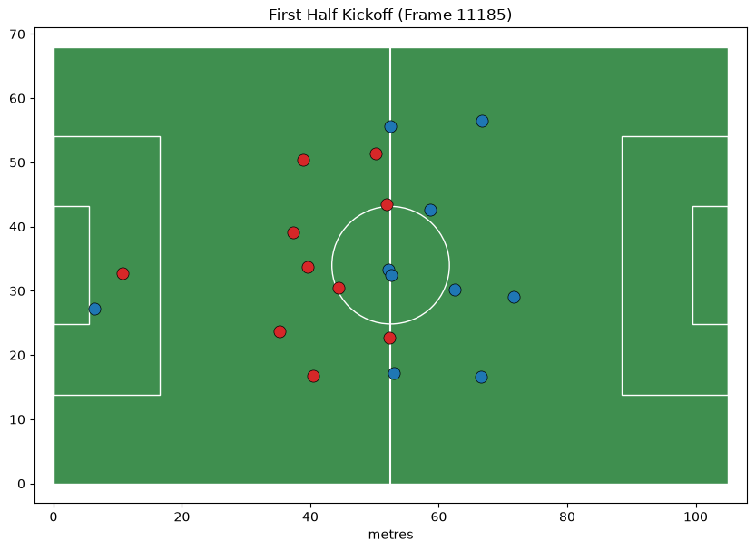
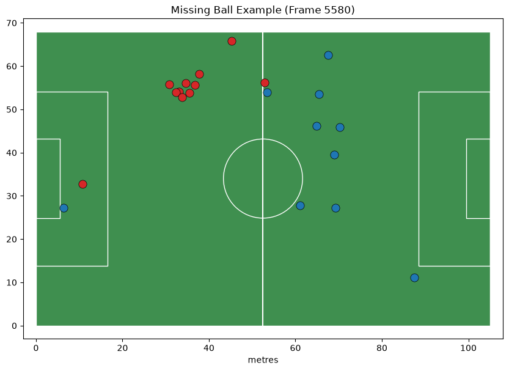

# Starter Notebooks & Tracking Data Guide

This folder contains starter notebooks, reference loaders, and baseline scripts for the **More Than A Hack 2027** challenge (FC Barcelona vs Athletic Club).

---

## 🏃📊 Tracking Notebook: `02_tracking_atd.ipynb`

The `02_tracking_atd.ipynb` notebook provides a guided tour for loading, verifying, inspecting, and visualizing the **Automatic Tracking Data (ATD)** produced by Metrica's computer-vision pipeline.

---

### 1. Inputs (What the Notebook Needs)

To run `02_tracking_atd.ipynb`, the following assets and modules are consumed:

#### A. Raw Data Assets (located in `data/tactical/`)
- **`BAR-ATH_tactical_atd.xml`**: Metadata file in Metrica FIFA/EPTS format defining pitch dimensions (`105 × 68 m`), team definitions, and 46 track slot channels.
- **`BAR-ATH_tactical_atd.txt`**: Tab-delimited tracking stream with position and speed records for all active tracks per frame (~195 MB).
- *(Paths are resolved dynamically via `games.asset_paths(source='tactical')`)*.

#### B. Repository Helper Modules
- **`games.py`**: Provides dataset paths, match constants, and pitch measurements.
- **`starter/load_atd.py`**: Fast streaming verification (`check_alignment_raw()`) to validate tracking records against video frames without loading the entire multi-gigabyte dataset into memory.
- **`starter/utils.py`**: Plotting (`plot_frame`) and dynamic HTML5 pitch rendering (`animate_frames`).

#### C. Python Dependencies
- `kloppy==3.18.0` (Metrica EPTS parser)
- `numpy`, `pandas`, `matplotlib`, `IPython`, `notebook`

---

### 2. What Data Can We Get From It?

The notebook extracts and exposes the following structured data:

| Feature / Column | Format | Description |
|---|---|---|
| **`frame_id`** | Integer ($1 \dots 199,319$) | Metrica tracking frame counter (1-indexed). |
| **`video_frame`** | Integer ($0 \dots 199,318$) | Aligned submission index calculated as $\text{frame\_id} - 1$. |
| **`ball_x`, `ball_y`** | Float $[0.0, 1.0]$ | Ball coordinates normalized to pitch $[0, 1]$ (or `NaN` when undetected). |
| **`ball_z`**, **`ball_speed`** | Float | Height of the ball and its instantaneous velocity. |
| **`<slot>_x`, `<slot>_y`** | Float $[0.0, 1.0]$ | Coordinates of track slot `<slot>` (slots 1 through 46), normalized to pitch $[0, 1]$. |
| **`<slot>_s`** | Float (m/s) | Instantaneous speed of track slot `<slot>` in meters per second. |
| **Team Membership** | Metadata | Mapping of track slots: 1–23 to Barcelona (`H`), 24–46 to Athletic (`A`). |
| **Pitch Dimensions** | Float (meters) | Real-world dimensions (`105.3 m × 68.0 m`) to convert normalized $[0, 1]$ coordinates into meters. |

---

### 3. Outputs & Visualizations (What the Notebook Produces)

Executing the notebook yields:

1. **Tabular DataFrame (`frame_df`)**:
   - A row-per-frame pandas DataFrame with **193 columns** containing all ball and player coordinates and speeds across loaded frames.
2. **Streaming Frame Alignment Report**:
   - Validation output confirming that the record count exactly matches the video duration (199,319 frames) with no missing indices.
3. **Ball Coverage Statistics**:
   - Verification of ball visibility (the ball is detected in ~56.9% of full-match frames, and missing on ~40.7% of graded frames).
4. **2D Pitch Plots (`plot_frame`)**:
   - Static Matplotlib pitch visualizations at key moments (e.g., frame 11,185 first-half kickoff), plotting Home and Away player clusters and ball position.
5. **Pitch Animation (`animate_frames`)**:
   - Interactive HTML5 / JavaScript pitch animation (`IPython.display.HTML`) visualizing 10-second sequences of spatial shape and ball progression.

---

### 4. Verified Execution Results & Sample Outputs

Running the notebook on the full match dataset produces the following verified results:

#### A. Alignment Verification (`check_alignment_raw`)
```text
n_records            199319
n_video_frames       199319
frame_id_range       (1, 199319)
contiguous           True
first_video_frame    0
agrees               True
```

#### B. Loaded DataFrame Dimensions & First 3 Rows
When loading the first 12,000 frames:
- **Shape:** `(12000, 193)`
- **Sample Data:**
  ```text
     frame_id  ball_x  ball_y      1_x      1_y       1_s
  0         1     NaN     NaN  0.33411  0.90565  0.886863
  1         2     NaN     NaN  0.33404  0.90487  0.886863
  2         3     NaN     NaN  0.33396  0.90413  0.886863
  ```

#### C. Ball Presence Statistics
- **Pre-Kickoff Window (first 12,000 frames):** Present on `984 / 12,000` frames (**8.2%**) due to warm-up / walk-out phases.
- **Match-Wide:** Present on `113,488 / 199,319` frames (**56.9%**).
- **Graded Play Frames:** Present on `94,214 / 158,857` frames (**59.3%**).

#### D. Pitch Visualizations

##### 1. First Half Kickoff (Video Frame 11,185)
Both teams positioned across their halves with the ball located at the center circle:



##### 2. Missing Ball Tracker Gap (Frame 5,580)
Demonstration of an occlusion where the ball is untracked (`NaN`) while player tracks remain active:



---

### 5. Critical Caveats for Downstream Modeling

When building models using the data extracted in this notebook, keep in mind:

- **No Player Re-Identification**:
  - The 46 track slots are **not** persistent player IDs or jersey numbers.
  - Track slots appear, disappear, and swap identities when players cluster or leave the camera view.
  - *Implication:* Models must rely on collective / spatial features (team centroids, convex hulls, team Voronoi partitions) rather than player tracking.
- **Ball Gaps (`NaN`)**:
  - The ball is missing on ~43% of frames due to aerial trajectories, camera occlusion, and crowded penalty boxes.
  - *Implication:* Feature pipelines must handle `NaN` gracefully (e.g., forward-fill, velocity interpolation, or proximity fallback).

---

### 6. Next Steps

- **`starter/01_smart_tagging.ipynb`**: Explores the tactical event markers (passes, recoveries, duels).
- **`starter/03_first_submission.ipynb`**: Combines tracking features with Smart Tagging to build, validate, and score an end-to-end possession baseline.

---

## 🏆 Machine Learning & Deep Learning Possession Benchmark

We engineered an end-to-end feature extraction and model benchmarking pipeline evaluated under 5-Fold Contiguous Out-of-Sample Cross-Validation on the official public ground truth window (`frames 11,185 .. 18,684`, 7,500 frames) using the official competition metric suite (`possession_metrics.py`).

### 1. Engineered Features (`starter/extract_features.py`)
Extracts **31 collective, permutation-invariant features** at >6,500 frames/second:
- **Ball Proximity & Pressure**: `d_margin` ($d_{away} - d_{home}$), `d_margin_sq`, `home/away_within_3m`, `home/away_within_5m`, `ball_speed`.
- **Collective Geometry & Spread**: Team centroids ($x, y$), `centroid_diff_x`, spatial dispersion standard deviation (`spread_x`, `spread_y`), and `spread_ratio`.
- **Kinematics & Stoppages**: `mean_speed_home`, `mean_speed_away`, `overall_speed` (critical discriminator for dead ball $D$).
- **Temporal Convolutions**: Multi-scale rolling moving averages ($1.0s, 2.0s, 3.0s$) and `d_margin_momentum`.

### 2. Benchmark Scoreboard Summary

| Rank | Model Architecture | `spellF1` (Ranked) | `macroF1` (Tie-break) | Accuracy | $F_1(H)$ | $F_1(A)$ | $F_1(D)$ | Spells | Mean Dur |
|:---:|:---|:---:|:---:|:---:|:---:|:---:|:---:|:---:|:---:|
| 🏆 1 | **ResNet-1D CNN (Smooth $w=50$ / 2.0s)** | **0.5875** | 0.7286 | 78.59% | 0.8638 | 0.7997 | **0.5223** | 15 | 17.7s |
| 🥈 2 | **CNN Blend (InceptionTime + ResNet, $w=35$)** | **0.5000** | **0.7447** | **80.07%** | 0.8774 | 0.8001 | **0.5566** | 15 | 18.2s |
| 🥉 3 | **ResNet-1D CNN (Smooth $w=25$ / 1.0s)** | **0.4889** | 0.7211 | 77.77% | 0.8548 | 0.7965 | 0.5120 | 19 | 13.9s |
| 4 | LogReg + Softmax Probability Smoothing ($w=50$) | 0.4686 | 0.6107 | 72.80% | 0.7706 | 0.7576 | 0.2312 | 18 | 16.0s |
| 5 | Temporal Neural Ensemble (TCN + BiGRU, $w=35$) | 0.4667 | 0.7017 | 78.37% | 0.8786 | 0.7857 | 0.4407 | 19 | 14.6s |
| 6 | Bidirectional GRU (Smooth $w=25$ / 1.0s) | 0.4513 | 0.7000 | 77.64% | 0.8704 | 0.7786 | 0.4510 | 22 | 12.5s |
| 7 | LogReg + Viterbi HMM Decoder | 0.4432 | 0.6141 | 73.10% | 0.8120 | 0.7420 | 0.2880 | 20 | 14.3s |
| 8 | InceptionTime 1D CNN (Smooth $w=50$ / 2.0s) | 0.4114 | 0.7227 | 79.15% | 0.8791 | 0.7894 | 0.4995 | 18 | 15.4s |
| 9 | Multinomial Logistic Regression (Raw) | 0.3404 | 0.6125 | 72.63% | 0.8313 | 0.7511 | 0.2553 | 30 | 9.5s |
| 10 | Nearest Player Baseline (Smooth $w=25$) | 0.3000 | 0.6307 | 69.23% | 0.7729 | 0.6962 | 0.4231 | 35 | 7.6s |
| 11 | Nearest Player Baseline (Raw Heuristic) | 0.0378 | 0.5972 | 65.12% | 0.7289 | 0.6432 | 0.4197 | 131 | 2.0s |
| **GT** | **Target Ground Truth (5-min public)** | *1.0000* | *1.0000* | *100.0%* | *1.0000* | *1.0000* | *1.0000* | **17** | **14.2s** |

*Generated PDF report: `More_Than_A_Hack_2027_Model_Benchmark.pdf`.*

