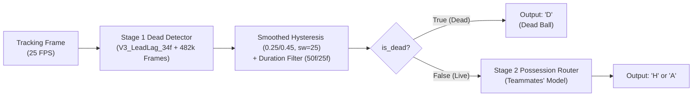

# Stage 1 Dead-Ball Detector (Combined Hierarchical Gate)

**More Than A Hack 2027: Tactical Ball Possession Prediction**  
*Combining PR #13 (5 Physical Pillars & Missing-Ball Resilience) + PR #14/16 (IDSSE 7-Match Corpus & 41% Ball-Gap Masking) + `V3_LeadLag_34f` Boundary Kinetics & `hyst_0.25_0.45_sw25` Decoding*

---

## 1. Overview & Teammate Interface Contract

This directory contains the production **Stage 1 Dead-Ball Detector** designed for the hierarchical possession prediction pipeline:



### Python Teammate Integration Example

```python
import numpy as np
from starter.stage1_dead_detector.dead_detector import Stage1DeadDetector

# 1. Initialize and load trained 5-booster ensemble (482,359 external frames, 34 features)
detector = Stage1DeadDetector(model_dir='models/stage1_dead_detector')
detector.load()

# 2. Predict calibrated P(Dead) for every frame
prob_dead = detector.predict_proba(df_match)

# 3. Predict filtered boolean gate (True = Dead, False = Live)
# Defaults: smooth_win=25, hyst=(0.25, 0.45), min_dead_frames=50, min_live_frames=25
is_dead = detector.predict_gate(df_match)

# 4. Hand off to Stage 2 (Live frames only):
live_indices = ~is_dead
team_preds = np.empty(len(df_match), dtype=object)
team_preds[is_dead] = 'D'
team_preds[live_indices] = your_stage2_model.predict(X_team[live_indices])
```

---

## 2. 11-Fold External LOMO Ablation & Combination Results

Evaluated via strict 11-fold Leave-One-Match-Out (LOMO) cross-validation (`ablate_stage1_improvements.py`) across SkillCorner (4 matches), IDSSE Clean (7 matches), and IDSSE 41%-Masked (7 matches) where the held-out match was **never seen during training**:

### Feature & Architecture Ablation (`hyst_0.32_0.55_sw15`)

| Variant | Mean ROC-AUC | Mean Dead F1 | Mean Int F1@0.5 | Mean Int F1 (0.3–0.7) | Outcome |
| :--- | :---: | :---: | :---: | :---: | :--- |
| `V0_Baseline_30f` | 0.9461 | 0.8535 | 0.6642 | 0.6626 | Baseline |
| `V1_SpeedMask_30f` | 0.9463 | 0.8468 | 0.6605 | 0.6509 | Constant-speed NaN mask only |
| `V2_MatchNorm_35f` | 0.9450 | 0.8352 | 0.6377 | 0.6286 | Dropped (z-scores hurt trees) |
| **`V3_LeadLag_34f`** | **0.9557** | **0.8715** | **0.7209** | **0.7026** | **Winner (+0.0567 Int F1@0.5)** |
| `V4_AllCombined_39f` | 0.9557 | 0.8656 | 0.6809 | 0.6718 | Hurt by `V2_MatchNorm` |

### `V3_LeadLag_34f` Domain Breakdown vs. `V0_Baseline_30f`

| Variant | Domain | ROC-AUC | Dead P | Dead R | Dead F1 | Int F1@0.5 | False-DEAD Bursts |
| :--- | :--- | :---: | :---: | :---: | :---: | :---: | :---: |
| `V0_Baseline_30f` | SkillCorner | 0.9647 | 0.8917 | 0.8982 | 0.8947 | 0.7355 | 13.5 |
| `V0_Baseline_30f` | IDSSE Clean | 0.9677 | 0.9821 | 0.7913 | 0.8713 | 0.7649 | **0.0** |
| `V0_Baseline_30f` | IDSSE 41%-Masked | 0.9139 | 0.9292 | 0.7316 | 0.8121 | 0.5228 | 1.4 |
| **`V3_LeadLag_34f`** | **SkillCorner** | **0.9657** | **0.8946** | 0.8967 | **0.8954** | 0.7259 | **12.8** |
| **`V3_LeadLag_34f`** | **IDSSE Clean** | **0.9707** | 0.9801 | **0.8017** | **0.8769** | **0.8087** | **0.0** |
| **`V3_LeadLag_34f`** | **IDSSE 41%-Masked** | **0.9351** | **0.9458** | **0.7817** | **0.8523** | **0.6302** | **0.7** |

### Hysteresis & Smoothing Calibration on `V3_LeadLag_34f` OOF Probabilities

| Decoder Config | Dead P | Dead R | Dead F1 | Int F1@0.5 | Mean Int F1 | False Bursts | Composite Score |
| :--- | :---: | :---: | :---: | :---: | :---: | :---: | :---: |
| `hyst_0.32_0.55_sw15` | **0.9477** | 0.8151 | 0.8715 | 0.7209 | 0.7026 | **3.1** | 0.7962 |
| `hyst_0.28_0.48_sw15` | 0.9367 | 0.8314 | 0.8757 | 0.7061 | 0.6963 | 3.9 | 0.7909 |
| `hyst_0.25_0.42_sw15` | 0.9253 | 0.8426 | 0.8769 | 0.7018 | 0.7004 | 4.4 | 0.7893 |
| `hyst_0.30_0.45_sw25` | 0.9329 | 0.8388 | 0.8780 | 0.7172 | 0.7130 | 3.8 | 0.7976 |
| **`hyst_0.25_0.45_sw25`** | 0.9243 | **0.8476** | **0.8792** | **0.7314** | **0.7235** | 4.2 | **0.8053** |

---

## 3. Production Training Corpus (482,359 Frames, 100% External)

Trained via `python starter/stage1_dead_detector/train_stage1_detector.py` on:
1. **SkillCorner 4 European Matches** (`272,359` frames; real broadcast ~52% ball gaps)
2. **IDSSE 7 Bundesliga Matches (Clean)** (`105,000` frames; TRACAB optical tracking)
3. **IDSSE 7 Bundesliga Matches (41% Ball-Gap Masked)** (`105,000` frames; simulated broadcast dropouts)

*(Metrica 3 games were excluded from training because Metrica only tags 2.3%–8.5% dead balls and leaves throw-ins labeled as Live, which suppresses `P(Dead)` recall.)*

---

## 4. Feature Schema (`DEAD_FEATURE_SCHEMA`, 34 Features)

1. **Pitch Boundary Violations**: `dist_to_boundary`, `is_out_of_bounds`, `near_boundary_1m`, `boundary_roll_1s`.
2. **Whole-Pitch Collective Kinetics (Whistle Signature)**: `speed_all_roll_2s`, `pitch_decel_2s`, `is_collective_walking`, `walking_roll_2s` *(masked to `NaN` when match `overall_speed.std() < 0.05` so constant-speed datasets like IDSSE don't split on dummy constants)*.
3. **Missing Ball Tracking Persistence**: `ball_missing`, `consecutive_missing`, `missing_over_1s`, `missing_over_3s`, `missing_ratio_roll_2s`, `missing_ratio_roll_5s`.
4. **Tactical Team Dispersion Expansion**: `home_spread_x/y`, `away_spread_x/y`, `total_spread_area`, `spread_area_roll_2s`.
5. **Player-to-Ball Physical Isolation & Coverage**: `min_dist_any`, `min_dist_roll_1s/3s/5s`, `ball_isolated_5m/10m`, `players_within_3m_total`, `players_3m_roll_1s`, `active_total`, `active_roll_2s`.
6. **Directional Lead/Lag Boundary Kinetics (Future 2s minus Past 2s)**: `spread_delta_fwd_2s`, `dist_delta_fwd_2s`, `missing_delta_fwd_2s`, `players3m_delta_fwd_2s`.
