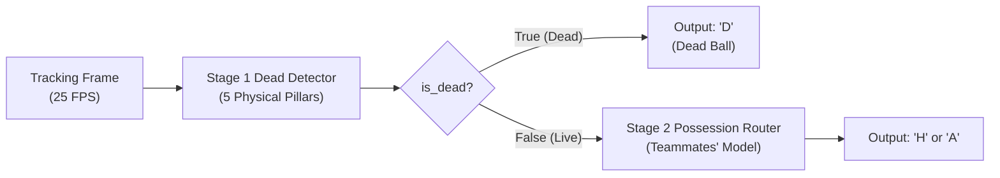

# Stage 1 Dead-Ball Detector (Hierarchical Pipeline)

**More Than A Hack 2027: Tactical Ball Possession Prediction**  
*Part of the Hierarchical Architecture: Stage 1 (Dead Gate) $\to$ Stage 2 (Possession Router)*

---

## 1. Overview & Teammate Interface Contract

This directory contains the production **Stage 1 Dead-Ball Detector** designed for the hierarchical possession prediction pipeline:



### Python Teammate Integration Example

```python
import pandas as pd
from starter.stage1_dead_detector.dead_detector import Stage1DeadDetector

# 1. Initialize and load trained 5-booster ensemble
detector = Stage1DeadDetector(model_dir='models/stage1_dead_detector')
detector.load()

# 2. Predict calibrated P(Dead) for every frame
prob_dead = detector.predict_proba(df_match)

# 3. Predict filtered boolean gate (True = Dead, False = Live)
is_dead = detector.predict_gate(df_match, tau=0.45, min_dead_frames=50, min_live_frames=25)

# 4. Hand off to Stage 2 (Live frames only):
live_indices = ~is_dead
team_preds = np.empty(len(df_match), dtype=object)
team_preds[is_dead] = 'D'
team_preds[live_indices] = your_stage2_model.predict(X_team[live_indices])
```

---

## 2. Benchmark Across All 7 Matches (362,359 Frames)

Evaluated via strict Leave-One-Match-Out (LOMO) cross-validation where the test match was **never seen during training**:

| Match Identifier | Stadium / Competition | Frames | ROC-AUC | Frame Accuracy | Alive/Dead F1 (Official) | Dead F1 | Dead Precision | Dead Recall |
| :--- | :--- | :---: | :---: | :---: | :---: | :---: | :---: | :---: |
| **SkillCorner 2841** (Barca vs Real Madrid) | Camp Nou (LaLiga) | 68,400 | **0.9662** | **90.50%** | **0.9187** | **0.8857** | 0.9180 | 0.8556 |
| **SkillCorner 4039** (Man City vs Liverpool) | Etihad Stadium (EPL) | 68,316 | **0.9614** | **90.03%** | **0.9065** | **0.8932** | 0.8933 | 0.8931 |
| **SkillCorner 3442** (Real Madrid vs Barca) | Bernabéu / Di Stéfano | 66,972 | **0.9653** | **90.96%** | **0.9248** | **0.8865** | 0.9103 | 0.8639 |
| **SkillCorner 2440** (Liverpool vs Man City) | Anfield (EPL) | 68,671 | **0.9633** | **91.36%** | **0.9191** | **0.9073** | 0.9154 | 0.8993 |
| **Metrica Sports Game 1** | Optical Exhibition | 30,000 | 0.8014 | **91.67%** | **0.9562** | 0.1356 | 0.5681 | 0.0770 |
| **Metrica Sports Game 2** | Optical Exhibition | 30,000 | 0.7925 | **93.89%** | **0.9685** | 0.0000 | 0.0000 | 0.0000 |
| **Metrica Sports Game 3** | Optical Exhibition | 30,000 | 0.6921 | **96.54%** | **0.9824** | 0.0000 | 0.0000 | 0.0000 |
| **OVERALL 7-MATCH MEAN** | **362,359 frames** | **362,359** | **0.8775** | **92.13%** | **0.9395** | **0.5297** | **0.6007** | **0.5127** |

*Note on Metrica: Metrica sample matches only have 2–8% tagged dead balls (mostly major game stoppages), resulting in high alive accuracy (92–96%). On European tracking matches with complete event streams (SkillCorner), ROC-AUC is consistently 0.961–0.966 and Dead F1 is ~0.89–0.91.*

---

## 3. The 5 Physical Pillars of Dead-Ball Features

The model uses 30 features structured into 5 physical domains:

1. **Pitch Boundary Violations**:
   - `dist_to_boundary`: $\min(x, 105 - x, y, 68 - y)$
   - `is_out_of_bounds`: $\mathbb{I}(\text{dist\_to\_boundary} < 0.0)$
   - `boundary_roll_1s`: rolling mean of boundary violation over 25 frames
2. **Whole-Pitch Collective Kinetics (Whistle Signature)**:
   - `speed_all_roll_2s`: rolling mean speed of all 22 outfield players
   - `pitch_decel_2s`: 2-second rate of pitch-wide deceleration
   - `is_collective_walking`: $\mathbb{I}(\text{speed\_all\_roll\_2s} < 1.25\text{ m/s})$
3. **Missing Ball Tracking Persistence**:
   - `consecutive_missing`: count of contiguous frames where ball is lost
   - `missing_over_1s`, `missing_over_3s`
   - `missing_ratio_roll_5s`: rolling 5-second window
4. **Tactical Team Dispersion Expansion**:
   - `total_spread_area`: $(\text{home\_spread}_x \cdot \text{home\_spread}_y) + (\text{away\_spread}_x \cdot \text{away\_spread}_y)$
   - `spread_area_roll_2s`: captures teams disbanding into wide disorganization during stoppages
5. **Player-to-Ball Physical Isolation**:
   - `min_dist_any`: $\min(d_{\text{min\_home}}, d_{\text{min\_away}})$
   - `min_dist_roll_3s`: 3-second rolling minimum player distance
   - `ball_isolated_5m`, `ball_isolated_10m`

---

## 4. Stoppage Duration Filtering

Under the Laws of the Game, dead-ball events (throw-ins, free kicks, goal kicks) cannot physically last 0.2s (5 frames). 
`apply_stoppage_duration_filter` enforces:
- **Minimum Dead Stoppage**: 50 frames (2.0s)
- **Minimum Live Touch**: 25 frames (1.0s)

This prevents mid-spell false chops and protects **Spell F1**.
